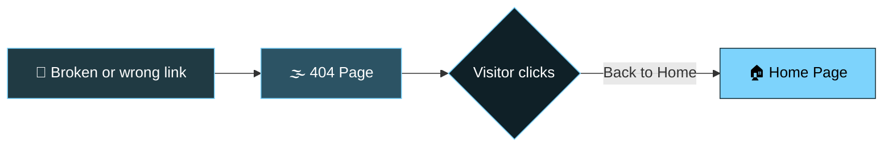

<div align="center">

<!-- Animated waving header -->


<!-- Typing animation -->
<a href="https://404errorpage-five.vercel.app/">
  
</a>

<br/>

<a href="https://404errorpage-five.vercel.app/">
  
</a>
<a href="https://github.com/MALIK25252007/404_ERROR_PAGE">
  
</a>

<br/><br/>


</div>

---

## 🌫️ About The Project

Nobody likes landing on a broken link, but a good error page can make it a little less annoying. **404 Error Page** is a clean, minimal and atmospheric "Page not found" page with a foggy theme and a playful message:

<div align="center">

> **404**
> ### Page not found
> *I tried to catch some fog, but I missed it.*

</div>

The whole page lives in a single `index.html` file, so it's easy to read, customize and drop into any website. Just point your server's 404 route at it.

Designed and built by **[Tarun Malik](https://github.com/MALIK25252007)**.

---

## 🌐 Live Preview

<div align="center">

### 👉 [**404errorpage-five.vercel.app**](https://404errorpage-five.vercel.app/) 👈

</div>

---

## ✨ Features

| | Feature | Description |
|---|---|---|
| 🌫️ | **Fog Theme** | Moody, atmospheric look with a playful error message |
| 🔢 | **Big 404 Display** | Large, eye-catching error code that's clear at a glance |
| 🏠 | **Back to Home Button** | Lets visitors get back on track right away |
| 📱 | **Responsive** | Works on mobile, tablet and desktop |
| ⚡ | **Lightweight** | A single HTML file with no heavy dependencies |
| 🧩 | **Easy to Customize** | Change the text, colors and link in minutes |
| 🚀 | **Deploy Anywhere** | Works on Vercel, Netlify, GitHub Pages or any web server |

---

## 🧭 User Flow



---

## 🛠️ Tech Stack

<div align="center">


</div>

- **HTML5** – page structure and content
- **CSS3** – styling, layout and visual effects
- **Vercel** – fast, free hosting for the live demo

---

## 📂 Project Structure

```
404_ERROR_PAGE/
├── 📄 index.html    # The complete 404 page
└── 📄 README.md     # You are here
```

---

## 🚀 Getting Started

**1. Clone the repository**

```bash
git clone https://github.com/MALIK25252007/404_ERROR_PAGE.git
```

**2. Go into the project folder**

```bash
cd 404_ERROR_PAGE
```

**3. Open it in your browser**

Double-click `index.html`, or run it with the VS Code **Live Server** extension.

---

## 🔌 Use It As Your Website's 404 Page

<details>
<summary><strong>▶ Vercel / Netlify / GitHub Pages</strong></summary>

<br/>

- **GitHub Pages:** rename the file to `404.html` and put it in the root of your site. GitHub Pages shows it automatically for missing pages.
- **Netlify:** name the file `404.html` in your publish folder. Netlify serves it for unknown routes.
- **Vercel:** name it `404.html` in your output folder (for static sites), or add a `404.html` / not-found route according to your framework.

</details>

<details>
<summary><strong>▶ Apache</strong></summary>

<br/>

Add this line to your `.htaccess` file:

```apache
ErrorDocument 404 /404.html
```

</details>

<details>
<summary><strong>▶ Nginx</strong></summary>

<br/>

Add this inside your `server` block:

```nginx
error_page 404 /404.html;
```

</details>

---

## 🎨 Customization

- **Message:** change the "Page not found" heading and the fog line in `index.html`
- **Colors & fonts:** edit the CSS inside the file to match your brand
- **Button link:** point the **Back to Home** button to your real homepage URL (right now it uses `#`)
- **Footer:** update the copyright text and credit line

---

## 🗺️ Roadmap

- [x] Clean foggy 404 layout
- [x] Back to Home button
- [x] Live deployment on Vercel
- [ ] Add more fog animation effects
- [ ] Light and dark mode toggle
- [ ] Search box to help visitors find pages
- [ ] Multiple theme options

---

## 🏷️ Topics / Tags

<div align="center">

`404-page` `error-page` `404-error` `page-not-found` `not-found` `html` `css` `html-css` `frontend` `web-design` `ui-design` `minimal-design` `responsive-design` `vercel` `single-page` `beginner-friendly` `open-source` `portfolio-project`

</div>

> 💡 **Tip:** Add these as repository topics on GitHub (⚙️ next to *About* → *Topics*) so people can discover your project.

---

## 🤝 Contributing

Ideas and improvements are welcome!

1. 🍴 Fork the project
2. 🌿 Create your feature branch (`git checkout -b feature/AmazingFeature`)
3. 💾 Commit your changes (`git commit -m 'Add some AmazingFeature'`)
4. 📤 Push to the branch (`git push origin feature/AmazingFeature`)
5. 🔁 Open a Pull Request

---

## 📜 License

This project is free to clone and use for personal projects. Credit to the author is appreciated.

---

## 📬 Contact

<div align="center">

**Tarun Malik**

[](https://github.com/MALIK25252007)
[](https://www.linkedin.com/in/tarun-malik-9bab21388)
[](https://www.instagram.com/_malik_200716)
[](https://wa.me/918279630850)
[](mailto:Malik1642007@gmail.com)

<br/>

### ⭐ If you like this project, give it a star! ⭐


</div>
